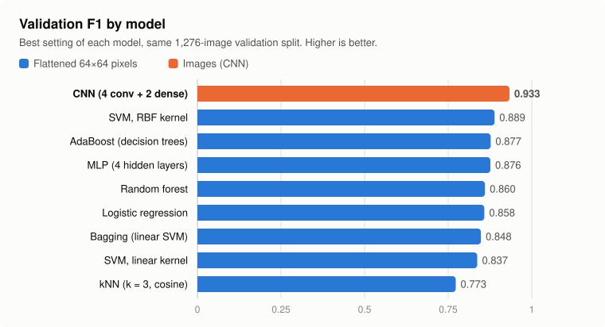
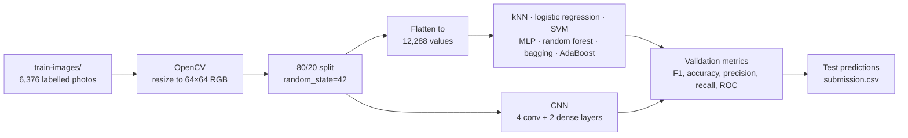
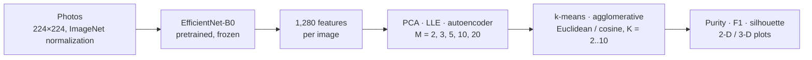
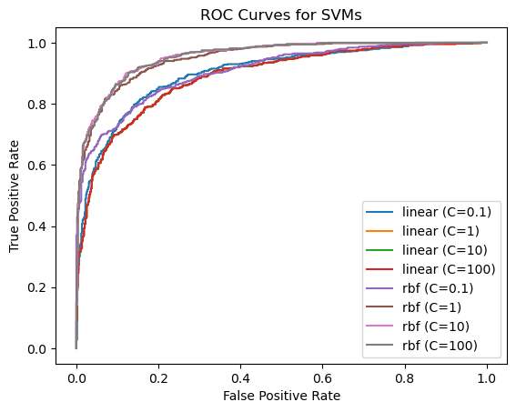
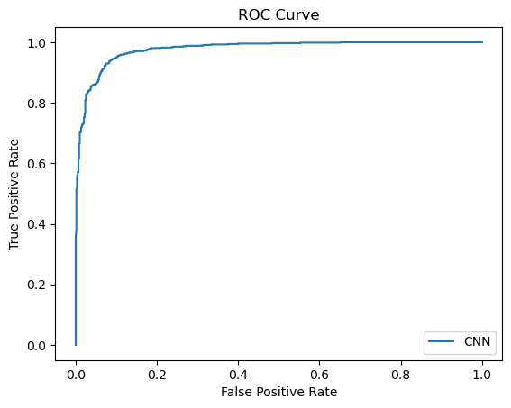
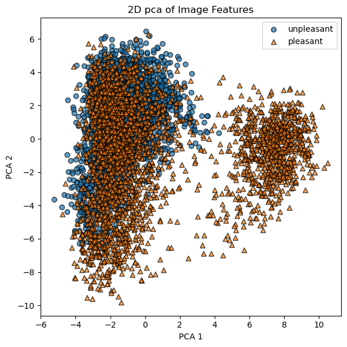
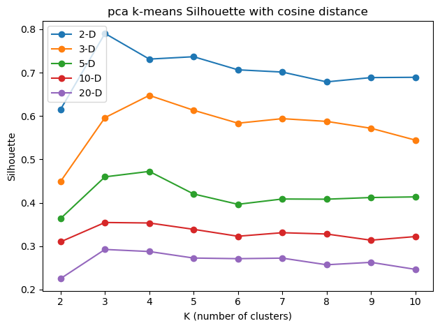

# Face Image Classification

Classifies face photos into two classes and compares classic machine-learning models with a convolutional neural network, in Python with scikit-learn, PyTorch and OpenCV. A second part clusters pretrained EfficientNet-B0 features after reducing their dimension with PCA, LLE and an autoencoder.


<picture>
  <source media="(prefers-color-scheme: dark)" srcset="docs/f1_by_model_dark.svg">
  
</picture>

**Result:** the CNN reached a validation F1 of **0.933**, against **0.889** for the best model on flattened pixels (an RBF SVM). Our best Kaggle submission, from an earlier version of the CNN, scored **F1 0.975** on the hidden test set. [All results](#results).

## About

- **Context:** Machine Learning course, Department of Computer Science & Engineering, University of Ioannina. Two assignments on the same data, solved as an in-class Kaggle competition.
- **Team:** Team project (2 students)
- **Status:** Complete as a course project. See [Limitations](#limitations-and-next-steps).

The first assignment: build a classifier that labels face photos as "pleasant" or "unpleasant" (the competition's class names), and compare classic machine-learning models with a convolutional neural network. Kaggle ranked submissions by F1 on 500 hidden test images.

The second assignment: use a pretrained CNN to turn each image into a feature vector, reduce its dimension, and study how well clustering recovers the two classes without seeing the labels.

We trained every Part 1 model on the same 80% of the 6,376 labelled photos and compared them on the same 20%, so the scores are directly comparable.

## Features

- Image loading and preprocessing with OpenCV: resizing to 64×64, RGB or grayscale, scaling, flattening
- Six model families on the same train/validation split:
  - k-nearest neighbors
  - fully connected neural network (MLP)
  - support vector machines
  - logistic regression
  - ensembles (random forest, bagging, AdaBoost)
  - a CNN
- Hyperparameter experiments for each one, e.g. k and distance metric, network depth and activation, SVM kernel and C, regularization strength, number of trees, convolution and dense layers
- Evaluation with accuracy, precision, recall, F1, confusion matrix and ROC curve; a Kaggle submission file for the 500 test images
- Part 2:
  - frozen EfficientNet-B0 features
  - PCA, LLE and an autoencoder down to 2–20 dimensions
  - k-means and agglomerative clustering with Euclidean and cosine distance
  - purity, F1 and silhouette for 2 to 10 clusters
  - 2-D and 3-D projections

## Tech stack

- **Language:** Python 3
- **Libraries:** scikit-learn, PyTorch, torchvision, OpenCV, NumPy, pandas, Matplotlib
- **Tools:** Jupyter, Kaggle

## How it works

### Part 1: classification



1. **Preprocessing:** each photo is read in color, resized to 64×64 pixels and scaled to [0, 1] (the kNN notebook keeps the raw 0–255 values).
2. **Split:** 80% for training, 20% (1,276 photos) for validation, with the same random seed in every notebook.
3. **Models on flattened pixels:** for kNN, logistic regression, the SVMs, the MLP and the ensembles, each image becomes a vector of 12,288 numbers (64 × 64 × 3).
4. **CNN:** works on the 64×64×3 images directly.
   - Four 3×3 convolution layers (32 to 256 filters), each with batch normalization, ReLU and 2×2 max pooling.
   - Dropout, a dense layer of 128 units and a 2-unit softmax output.
   - Trained with Adam for 15 epochs.
5. **Evaluation:** every notebook prints accuracy, precision, recall, F1 and the confusion matrix on the validation set and draws the ROC curve. It then predicts the 500 test images and writes `submission.csv`.

### Part 2: clustering



The labels are used only to score the clusters:
- **Purity:** the share of images in the majority class of their cluster.
- **F1:** after mapping each cluster to its majority class.
- **Silhouette:** how well separated the clusters are, without labels.

### Design decisions

- **64×64 color images for the classic models:** we also tried 16×16, 32×32, 128×128 and 256×256 pixels, and grayscale. 64×64 in color gave the best balance of speed and accuracy; grayscale was faster but slightly worse. Trade-off: the classic models get 12,288 raw pixel values with no notion of which pixels are neighbors, and the SVM-based ensembles were slow to train on them.
- **One fixed split for every model:** every Part 1 notebook uses the same 80/20 split, so all models are scored on the same 1,276 photos. Trade-off: it is a single split with no cross-validation, so differences of about 0.01 F1 may be noise.
- **F1 as the selection metric:** it is the metric Kaggle ranked by, and the SVM notebook picks its final model by F1 automatically. The other metrics are still reported, because F1 alone hides the precision/recall balance. For example, kNN reached 0.91 precision but only 0.67 recall.
- **A CNN on the images instead of flattened pixels:** convolution and pooling use the 2-D structure of the image. That gave the largest single improvement of the project, about +0.04 F1 over the best classic model. Trade-off: more settings to tune and results that vary between runs.
- **Frozen EfficientNet-B0 for Part 2:** a pretrained network gives meaningful features without training. EfficientNet-B0 gave better results than VGG16 and ResNet18 in our tests, and its 1,280-value vectors are much smaller than VGG16's 25,088.

## Getting started

### Prerequisites

- Python 3 and Jupyter
- The competition data (not included, see [Dataset](#dataset))
- A GPU is optional. Notebook 07 uses CUDA if it is available.

### Installation

```bash
git clone https://github.com/KonstantinosChatzopoulos/face-image-classification.git
cd face-image-classification
pip install -r requirements.txt
```

### Run

1. Put the competition data in the `notebooks/` folder. The notebooks read it from their own folder:

   ```text
   notebooks/
   ├── train-images/train/pleasant/*.jpg
   ├── train-images/train/unpleasant/*.jpg
   ├── TEST_images/TEST_images/*.jpg
   └── Test-IDs.csv
   ```

2. Start Jupyter and run a notebook from top to bottom:

   ```bash
   jupyter notebook notebooks/06_cnn.ipynb
   ```

Each Part 1 notebook prints its validation metrics, draws the ROC curve and writes `submission.csv` in `notebooks/`. Notebook 07 downloads the EfficientNet-B0 weights on its first run. On our machines the CNN trained in about two minutes, while bagging and AdaBoost were very slow.

## Dataset

The data comes from the course's in-class Kaggle competition and is not redistributed here. It consists of photos of real people, so this repo includes no sample images.

| Folder / file | Contents |
|---|---|
| `train-images/train/pleasant/` | 3,394 JPEG face photos, label 1 |
| `train-images/train/unpleasant/` | 2,982 JPEG face photos, label 0 |
| `TEST_images/TEST_images/` | 500 unlabelled photos |
| `Test-IDs.csv` | `ID,Filename` for the 500 test photos |

The photos vary in size, roughly 100 to 400 pixels per side; the notebooks resize them. The submission has one row per test photo, `ID,LABEL`, with 1 for pleasant and 0 for unpleasant.

## Notebooks

| Notebook | Model | Setting in the saved run |
|---|---|---|
| [01_knn](notebooks/01_knn.ipynb) | k-nearest neighbors | k = 3, cosine distance |
| [02_mlp](notebooks/02_mlp.ipynb) | Fully connected network (PyTorch) | hidden layers [512, 256], PReLU, Adam |
| [03_svm](notebooks/03_svm.ipynb) | SVM, linear and RBF kernels | all 8 kernel/C pairs; retrains the best (RBF, C = 10) |
| [04_logistic_regression](notebooks/04_logistic_regression.ipynb) | Logistic regression | C = 0.5, lbfgs |
| [05_ensembles](notebooks/05_ensembles.ipynb) | Random forest, bagging (linear SVM), AdaBoost (decision trees) | 3 forests, 20 SVMs, 200 boosting rounds |
| [06_cnn](notebooks/06_cnn.ipynb) | CNN (PyTorch) | 4 convolution + 2 dense layers |
| [07_clustering_efficientnet_features](notebooks/07_clustering_efficientnet_features.ipynb) | EfficientNet-B0 features → PCA / LLE / autoencoder → k-means / agglomerative | full sweep |

Each notebook starts with a short description of what it does and where its data goes.

## Results

### Part 1: classification

Best setting of each model on the 1,276-photo validation set. The positive class is "pleasant".

| Model | Input | Best setting | Accuracy | Precision | Recall | F1 |
|---|---|---|---|---|---|---|
| kNN | pixels | k = 3, cosine distance | 0.788 | 0.909 | 0.672 | 0.773 |
| SVM, linear kernel | pixels | C = 0.1 | 0.828 | 0.847 | 0.827 | 0.837 |
| Bagging | pixels | 10 linear SVMs | 0.840 | 0.863 | 0.833 | 0.848 |
| Logistic regression | pixels | C = 0.05, liblinear | 0.853 | 0.886 | 0.832 | 0.858 |
| Random forest | pixels | 200 trees, max depth 20 | 0.857 | 0.901 | 0.823 | 0.860 |
| MLP | pixels | [512, 256, 512, 256], PReLU, Adam (lr 0.0001), 20 epochs | 0.869 | 0.886 | 0.867 | 0.876 |
| AdaBoost | pixels | 200 decision trees of depth 3 | 0.871 | 0.897 | 0.858 | 0.877 |
| SVM, RBF kernel | pixels | C = 10 | 0.882 | 0.900 | 0.878 | 0.889 |
| **CNN** | **images** | **4 conv + 2 dense layers** | **0.928** | **0.924** | **0.943** | **0.933** |

The numbers come from our course report, except AdaBoost's, which come from the saved notebook (the report has F1 0.854 with 100 rounds). Two notebooks hold a later setting than the best one: the logistic regression notebook shows F1 0.838 (C = 0.5, lbfgs) and the MLP notebook 0.856 (hidden layers [512, 256]).

On Kaggle, the best submission scored **F1 0.975** on the 500 test photos. It came from an earlier CNN with 3 convolution layers and 1 dense layer, before dropout and the softmax output were added; that version scored about 0.935 on validation. The 4 + 2 version above scored higher on validation, but not on Kaggle.

<p>
  
  
</p>

<details>
<summary>All hyperparameter experiments from the report (F1)</summary>

**kNN**, Euclidean distance:

| k | 1 | 2 | 3 | 4 | 5 | 6 | 7 |
|---|---|---|---|---|---|---|---|
| F1 | **0.757** | 0.681 | 0.733 | 0.686 | 0.731 | 0.691 | 0.717 |

**kNN**, cosine distance:

| k | 1 | 3 | 5 | 7 |
|---|---|---|---|---|
| F1 | 0.767 | **0.773** | 0.761 | 0.755 |

Odd values of k did better, probably because an even number of neighbors can tie. Larger k made results worse.

**SVM:**

| Kernel | C = 0.1 | C = 1 | C = 10 | C = 100 |
|---|---|---|---|---|
| Linear | **0.837** | 0.819 | 0.819 | 0.819 |
| RBF | 0.819 | 0.880 | **0.889** | 0.885 |

**Logistic regression** (`max_iter=1000`):

| Solver | C = 0.01 | C = 0.05 | C = 0.1 | C = 0.5 |
|---|---|---|---|---|
| liblinear | 0.849 | **0.858** | 0.852 | 0.839 |
| lbfgs | 0.847 | 0.856 | 0.853 | 0.838 |

**MLP:** we tried 1 to 4 hidden layers of different sizes, four activations (ReLU, sigmoid, tanh, PReLU) and two optimizers (Adam, SGD). The best runs used 15–20 epochs, Adam learning rates between 0.001 and 0.00001, and SGD learning rates between 0.1 and 0.001. Selected runs:

| Hidden layers | Activation | Optimizer | Epochs | Accuracy | Precision | Recall | F1 |
|---|---|---|---|---|---|---|---|
| 512, 256, 512, 256 | PReLU | Adam, lr 0.0001 | 20 | 0.869 | 0.886 | 0.867 | **0.876** |
| 512, 256, 512, 256 | sigmoid | Adam, lr 0.0001 | 20 | 0.857 | 0.853 | 0.884 | 0.868 |
| 512, 256 | PReLU | Adam, lr 0.0001 | 20 | 0.858 | 0.936 | 0.789 | 0.856 |
| 512, 256, 512, 256 | PReLU | Adam, lr 0.0001 | 15 | 0.838 | 0.939 | 0.745 | 0.831 |
| 512, 256, 512, 256 | PReLU | Adam, lr 0.001 | 20 | 0.836 | 0.942 | 0.739 | 0.829 |
| 512, 256, 512, 256 | PReLU | SGD, lr 0.01 | 20 | 0.732 | 0.680 | 0.943 | 0.790 |

**Ensembles:**

| Model | Setting | F1 |
|---|---|---|
| Random forest | 50 trees, no depth limit | 0.836 |
| Random forest | 100 trees, max depth 10 | 0.843 |
| Random forest | 200 trees, max depth 20 | **0.860** |
| Bagging, linear SVM | 10 estimators | 0.848 |
| Bagging, linear SVM | 20 estimators | 0.848 |
| AdaBoost, trees of depth 3 | 100 estimators (report) | 0.854 |
| AdaBoost, trees of depth 3 | 200 estimators (saved notebook) | **0.877** |

**CNN:** we tried 2 to 5 convolution layers and 1 to 3 dense layers, epochs between 5 and 50 (about 15 worked best), and several learning rates (small ones worked better). With dropout and a softmax output:

| Convolution layers | Dense layers | Accuracy | Precision | Recall | F1 |
|---|---|---|---|---|---|
| 3 | 2 | 0.911 | 0.951 | 0.878 | 0.913 |
| 3 | 1 | 0.920 | 0.919 | 0.933 | 0.926 |
| 4 | 1 | 0.926 | 0.958 | 0.900 | 0.928 |
| 4 | 2 | 0.928 | 0.924 | 0.943 | **0.933** |

We also tried automatic hyperparameter search with Optuna. It took about 3 hours and found nothing better than our manual settings.

</details>

## Part 2: clustering pretrained features

<p>
  
  
</p>

The EfficientNet-B0 features of the 5,100 training photos were reduced to M = 2, 3, 5, 10 and 20 dimensions, then clustered with K = 2 to 10.

**PCA explained variance:**

| M | 2 | 3 | 5 | 10 | 20 |
|---|---|---|---|---|---|
| Explained variance | 23.4% | 28.5% | 35.6% | 46.9% | 58.9% |

Findings, from our report and the saved plots:

- **The two classes overlap heavily.** In the 2-D PCA projection, one group of pleasant photos stands apart, while the rest of both classes overlap. K-means can't separate the two labels.
- **Silhouette and the label-based metrics disagree.** The best silhouette came from PCA in 2 dimensions with cosine distance and K = 3 (about 0.79), matching the separate group above. Purity and F1 kept improving as K and M grew; for PCA with k-means and cosine distance, purity rose from about 0.70 at K = 3 to between 0.72 and 0.76 at K = 10, depending on M. (Putting every photo in one cluster would give a purity of 0.53.)
- **PCA:** fastest, since it is linear, and gives clear low-dimensional plots. With Euclidean distance the metrics were better in more dimensions; with cosine distance, in the middle range.
- **LLE:** slower than PCA. We chose 200 neighbors, the value at which the classes started to separate in the plots. It gave good silhouette scores with few dimensions and clusters, while purity and F1 improved as both grew.
- **Autoencoder:** the slowest, with the most settings to tune, and its low-dimensional plots were hard to interpret. Clustering improved steadily with more clusters and dimensions: moderate silhouette, better purity and F1.

Overall, PCA is the best choice for quick, readable plots. LLE shows local structure, and the autoencoder gives a good but hard-to-interpret representation at a higher cost. The best number of clusters was mostly K = 2, and in some cases K = 3.

## Project structure

```text
face-image-classification/
├── notebooks/
│   ├── 01_knn.ipynb                                # k-nearest neighbors
│   ├── 02_mlp.ipynb                                # fully connected network
│   ├── 03_svm.ipynb                                # SVMs, linear and RBF kernels
│   ├── 04_logistic_regression.ipynb
│   ├── 05_ensembles.ipynb                          # random forest, bagging, AdaBoost
│   ├── 06_cnn.ipynb                                # convolutional network (best model)
│   └── 07_clustering_efficientnet_features.ipynb   # Part 2
├── docs/                                           # result chart and plots
├── requirements.txt
├── LICENSE
└── README.md
```

## What I learned

- Setting up a fair comparison: one split, the same metrics for every model, and one metric to choose by
- How much image structure matters: a small CNN beat every model that saw the same pixels as a flat vector
- Reading precision and recall together instead of a single score, e.g. kNN's high precision but low recall
- A better validation score doesn't guarantee a better test score: the CNN that was best on validation wasn't best on Kaggle
- How PCA, LLE and autoencoders differ in speed, setup cost and interpretability, and that silhouette and label-based clustering metrics can point to different numbers of clusters

## Limitations and next steps

- **One validation split:** all numbers come from a single 80/20 split, without cross-validation, so small differences between models may be noise.
- **Run-to-run variation:** PyTorch isn't seeded, so MLP and CNN results change slightly between runs.
- **Notebooks keep the last setting tried:** the experiments were run by editing settings and re-running cells. The full results are in our course report, and two notebooks don't hold their best setting (see [Results](#results)).
- **Raw pixels only in Part 1:** the classic models use no feature extraction, and with 12,288 features the SVM-based ensembles were slow.
- **Known code issues, left as they are:**
  - The MLP's ROC curve is drawn from 0/1 predictions instead of probabilities, so it is not a real ROC curve.
  - The CNN ends with a softmax layer, as the assignment asked, and is trained with `CrossEntropyLoss`, which applies softmax again.
  - The last experiment in the ensembles notebook (AdaBoost over a random forest) prints the previous model's metrics instead of its own.
  - In notebook 07, the k = 3 cluster plot draws only two of the three clusters. The disabled AdaBoost cells use `algorithm='SAMME.R'`, which scikit-learn 1.6 removed.
- **What the models rely on:** we didn't check which parts of the photo drive the predictions, e.g. the face itself or the background, lighting and framing.

Next steps:
- cross-validation and fixed seeds
- classifiers trained on the pretrained EfficientNet-B0 features from Part 2
- data augmentation
- saliency maps (e.g. Grad-CAM) to see what the CNN looks at

## Acknowledgments

- Built with a teammate as a two-person course project.
- The tasks and the dataset come from the course and its Kaggle competition, set by the course instructor. They are not included in this repo.
- The pretrained EfficientNet-B0 weights come from torchvision.
- AI assistance: this README, the notebooks' markdown descriptions, the result chart and the repository layout were prepared with AI assistance. The notebooks' code is the code we submitted for the course.

## License

Released under the [MIT License](LICENSE).
